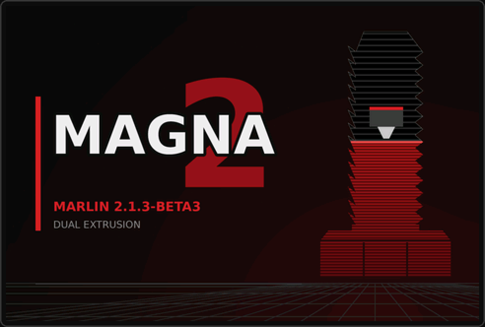
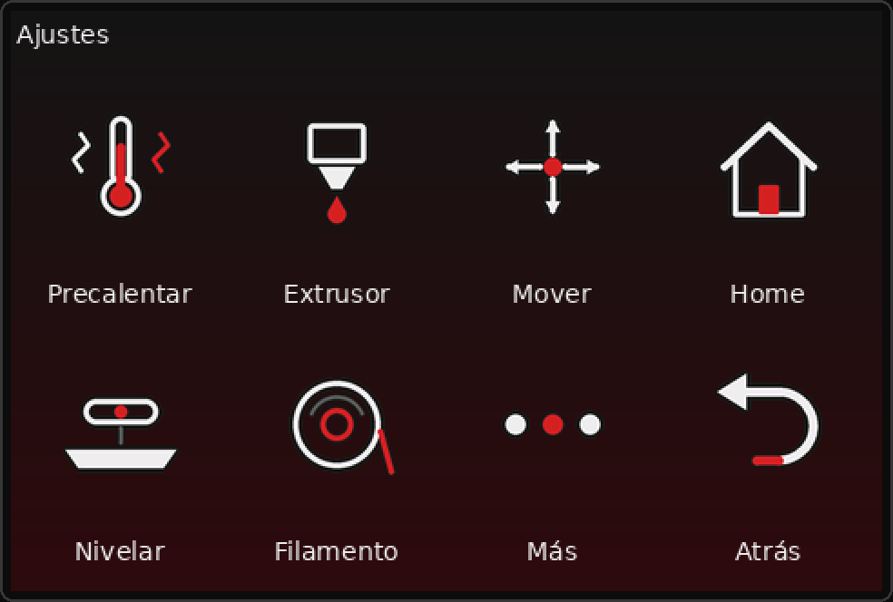
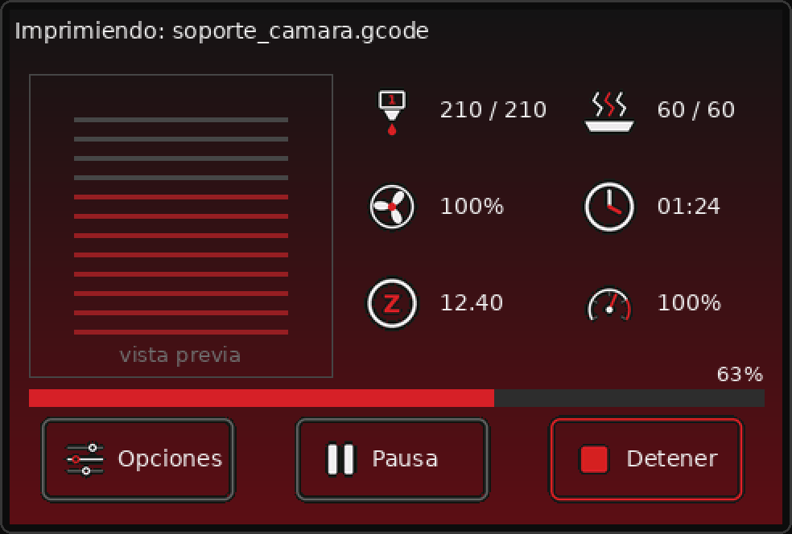
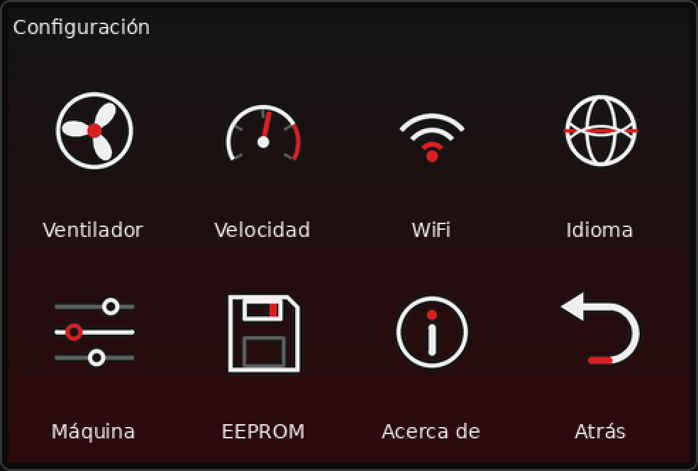
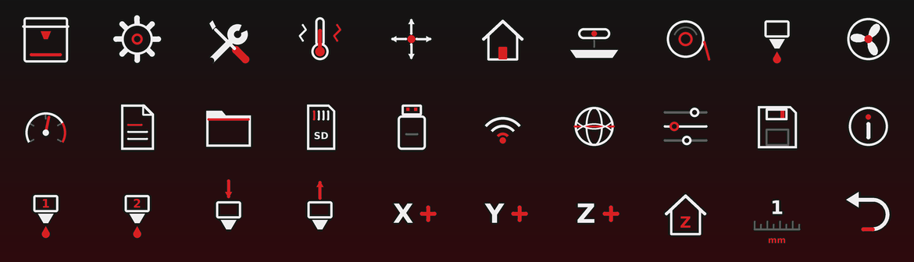

# Marlin 2.1.3 para Hellbot Magna 2 230

Firmware **Marlin 2.1.3-beta3** configurado para la impresora 3D **Hellbot Magna 2 230**, con placa **MKS Robin Nano V1.3** y pantalla táctil **MKS TFT35**. Incluye un tema visual propio para la pantalla, perfiles para Cura, PrusaSlicer y OrcaSlicer, y compilación automática en GitHub Actions.

<p align="center">
  
  
</p>

---

## Contenido

- [Qué trae](#qué-trae)
- [Hardware compatible](#hardware-compatible)
- [Firmware](#firmware)
- [Tema de la pantalla](#tema-de-la-pantalla)
- [Perfiles de slicer](#perfiles-de-slicer)
- [Firmware del WiFi](#firmware-del-wifi)
- [Cómo compilar](#cómo-compilar)
- [Cómo instalar en la impresora](#cómo-instalar-en-la-impresora)
- [Calibración después de instalar](#calibración-después-de-instalar)
- [Pruebas automáticas](#pruebas-automáticas)
- [Estructura del repositorio](#estructura-del-repositorio)
- [Créditos y licencia](#créditos-y-licencia)

---

## Qué trae

| | |
|---|---|
| **Firmware** | Marlin oficial 2.1.3-b3 con la configuración de la Magna 2 230 |
| **Pantalla** | Interfaz MKS (LVGL) táctil, en español, con tema propio negro, rojo y blanco |
| **Mejoras** | Linear Advance, Input Shaping, control de temperatura MPC, cambio automático de filamento para el hotend 2 en 1 y más (ver abajo) |
| **Slicers** | Perfiles para Cura 5, PrusaSlicer 2.6+ y OrcaSlicer 2.x |
| **WiFi** | Firmware oficial del módulo MKS Robin WiFi (opcional) |
| **Compilación** | Automática en GitHub Actions: subís `mm2.zip` y te devuelve todo listo para la SD |

## Hardware compatible

| Componente | Modelo |
|---|---|
| Impresora | Hellbot Magna 2 230 (230 × 230 × 250 mm) |
| Placa | MKS Robin Nano **V1.3** (STM32F407VET6, 512 KB) |
| Pantalla | MKS TFT35 táctil (480 × 320) |
| Extrusión | Doble extrusor Dual Drive con hotend **2 en 1** (una boquilla) |
| Drivers | TMC2209 (X/Y) en modo standalone |
| WiFi | MKS Robin WiFi (ESP8266) |

> ⚠️ Este firmware es **solo para la Robin Nano V1.3**. La V1.2 (STM32F103) y la V3 usan otros firmwares.

## Firmware

**Base:** Marlin oficial **2.1.3-b3**, idéntico al release de MarlinFirmware. El repositorio guarda solo los archivos propios de la Magna. La versión de Marlin está en `MARLIN_VERSION` y GitHub Actions la descarga al compilar.

Los valores mecánicos (pasos, direcciones de motores, finales de carrera, termistores, aceleraciones y PID de la cama) se tomaron de un firmware 2.1.2.1 que ya funcionaba en esta máquina. El detalle de cada valor y de dónde sale está en [`docs-magna/CONFIGURACION.md`](docs-magna/CONFIGURACION.md).

### Configuración principal

| Parámetro | Valor |
|---|---|
| Placa (`MOTHERBOARD`) | `BOARD_MKS_ROBIN_NANO_V1_3_F4` |
| Entorno de compilación | `mks_robin_nano_v1_3_f4` |
| Área de impresión | 230 × 230 × 250 mm |
| Pasos/mm X · Y · Z · E0 · E1 | 80 · 80 · 400 · 425 · 423 |
| Velocidad máxima | 300 · 300 · 5 · 25 · 25 mm/s |
| Aceleración máxima | 2000 · 2000 · 100 · 8000 · 8000 mm/s² |
| Aceleración impresión / viaje | 2000 / 2000 mm/s² |
| Jerk X · Y · Z · E | 10 · 10 · 0.3 · 5 |
| Termistores hotend / cama | Tipo 1 (100k NTC) |
| Temperatura máxima hotend / cama | 275 °C / 120 °C |
| Extrusores | 2, con boquilla única (`SINGLENOZZLE`) |
| Sensores de filamento | 2 (uno por extrusor) |
| Puerto serie | UART3, 115200 baudios |

### Funciones activadas

| Función | Para qué sirve |
|---|---|
| **Cambio de filamento 2 en 1** | Los perfiles de slicer retiran el filamento 100 mm (por encima de la unión) y cargan el otro, como el perfil de fábrica. El firmware trae `TOOLCHANGE_FILAMENT_SWAP` para cambios a mano (`M217 S100`) |
| **Input Shaping** X/Y | Reduce el *ringing* y permite imprimir más rápido. Se ajusta con `M593` |
| **MPC** (control predictivo de temperatura) | Temperatura del hotend más estable que con PID. Se calibra con `M306 T` |
| **Linear Advance** | Compensa la presión en la boquilla: esquinas más limpias. `M900` por extrusor |
| **S-Curve**, jerk clásico, límite de frecuencia XY, suavizado adaptativo de pasos | Movimiento más suave y menos vibración |
| **Sensores de filamento** (2) | Pausa si se acaba el filamento, 15 mm después de detectarlo (`M412`) |
| **Pausa y cambio de filamento** (`M600`) | Aparta el cabezal y espera el cambio, con "purgar más / continuar" en la pantalla |
| **Recuperación ante cortes de luz** | Retoma la impresión desde la SD |
| **Apagado por inactividad** | Si el hotend está caliente y quieto 10 min, apaga los calentadores |
| **Cancelar objetos** (`M486`) | Cancela una pieza que falló sin parar las demás |
| **Tiempo restante del slicer** (`M73`) | La pantalla muestra el tiempo calculado por el slicer |
| **Babystepping** | Ajusta Z en vivo durante la primera capa |
| **Contador de impresiones**, **EEPROM** | Estadísticas y configuración guardada con `M500` |
| **WiFi MKS** | Envío de archivos y control por red |
| **Botones propios en Ajustes → Más** | Calibrar hotend, calibrar cama, estacionar y cargar cada filamento del 2 en 1, con un toque y sin escribir comandos |

## Tema de la pantalla

Tema propio, minimalista: fondo oscuro con degradé, íconos de trazo blanco con detalles en rojo, y una pantalla de arranque con una pieza impresa en capas. Todos los íconos y la pantalla de arranque están generados por código en [`assets-tema/`](assets-tema/), sin imágenes de terceros.

<p align="center">
  
  
</p>
<p align="center">
  
  
</p>
<p align="center">
  
</p>

<p align="center">
  
</p>

- **138 archivos:** mismo formato y tamaño que los originales de Makerbase, así que reemplazan a los de fábrica sin cambiar el firmware.
- **Íconos transparentes:** dejan ver el fondo de la pantalla.
- **Fondo y colores:** el degradé, los colores de los menús y la decoración de la pantalla principal los aplica [`assets-tema/aplicar_colores.py`](assets-tema/aplicar_colores.py) al compilar.
- **Menús de íconos:** franja oscura del título con acento rojo, "MAGNA 2" a la derecha, línea roja con marcas tipo regla, separador punteado entre filas y tres líneas de capas abajo ([`assets-tema/decoracion_menus.inc`](assets-tema/decoracion_menus.inc)). Se dibuja junto con el fondo de la pantalla, sin agregar objetos. En Mover y Babystep no lleva "MAGNA 2", porque ahí arriba a la derecha va la posición.
- **Mensajes con letra grande:** todos los mensajes (carga y retiro de filamento, pausa, errores, WiFi, etc.) usan una letra de 26 px en vez de 16, con salto de línea automático, y los botones bajan para dejarle lugar. La letra ([`generar_fuente.py`](assets-tema/generar_fuente.py), Roboto con acentos y ñ) se usa en español, inglés, portugués, italiano, francés y alemán; en los otros idiomas queda la original.
- **Barras de progreso del tema:** la de carga/descarga de filamento y la de impresión son rojas, redondeadas y sobre fondo oscuro. El porcentaje de impresión va con la letra grande ([`assets-tema/estilo_dialogos.inc`](assets-tema/estilo_dialogos.inc)).
- **Para volver a los íconos de fábrica:** copiá a la SD la carpeta `assets` original de Makerbase.

> Las capturas de "Más" y del mensaje de carga son el dibujo real de la librería gráfica de la pantalla (LVGL 6.1 de MKS) con el mismo código del firmware (`pruebas/render-lvgl`); las demás son una simulación hecha con los mismos archivos ([`generar_capturas.py`](assets-tema/generar_capturas.py)).

## Perfiles de slicer

En [`perfiles-slicer/`](perfiles-slicer/), ajustados a esta máquina y a este firmware:

| Slicer | Archivos | Cómo se importa |
|---|---|---|
| **Cura 5.10 o superior** | `cura/` (máquina, extrusores y calidades por material) | Doble clic en `cura/instalar-windows.bat` (o `instalar-mac-linux.sh`): lo copia en la carpeta de la versión más nueva de Cura |
| **PrusaSlicer 2.6+** | `prusaslicer/Magna2-230_PrusaSlicer_bundle.ini` | Archivo → Importar → Importar paquete de configuración |
| **OrcaSlicer 2.x** | `orcaslicer/machine`, `process`, `filament` | Archivo → Importar → Importar configuraciones |

- **Calidades:** 0.12 Fina · 0.20 Normal · 0.28 Borrador.
- **Filamentos:** PLA · PETG · ABS.
- **G-code de inicio:** doble línea de purga. Al terminar, el cabezal se aparta y presenta la pieza.
- **Cambio de extrusor:** lo hace el firmware, así que la retracción de cambio del slicer va en 0.

Todos se generan desde un único script ([`generar_perfiles.py`](perfiles-slicer/generar_perfiles.py)), así quedan coherentes entre sí. Más detalles en [`perfiles-slicer/README.md`](perfiles-slicer/README.md).

## Firmware del WiFi

[`wifi/MksWifi.bin`](wifi/) es el **firmware oficial de Makerbase CS1.0.4_200227** para el módulo MKS Robin WiFi (ESP8266). Es opcional: solo hace falta para actualizar o reparar el WiFi. Ver [`wifi/README.md`](wifi/README.md).

## Cómo compilar

### Con GitHub Actions (recomendado)

1. **Solo la primera vez:** crear en el repo `.github/workflows/compilar-mm2.yml` y `.github/workflows/publicar-release.yml` con el contenido de los archivos de [`github-workflows/`](github-workflows/).
2. Subir **`mm2.zip`** a la raíz del repo (Add file → Upload files).
3. El workflow hace todo solo:
   1. descomprime el zip en el repo y guarda los archivos;
   2. descarga Marlin oficial (la versión de `MARLIN_VERSION`);
   3. le aplica la configuración y el tema;
   4. corre las pruebas y compila.
4. En **Actions → Compilar Magna 2 230 (mm2.zip)** se descarga el artefacto **`Magna2-230-firmware`**:

```
Magna2-230-firmware/
├── Robin_nano35.bin      ← firmware
├── assets/               ← íconos, logo y fuente de la pantalla
├── opcional-wifi/        ← firmware del WiFi (solo si se quiere actualizar)
└── COMO-FLASHEAR.md
```

### Publicar una versión (Releases)

El workflow [`publicar-release.yml`](github-workflows/publicar-release.yml) compila y publica una versión descargable en la pestaña **Releases**:

- **A mano:** **Actions → Publicar versión Magna 2 230 → Run workflow**, con un nombre (por ejemplo `v1.0`) o vacío para usar la fecha. Opcionalmente, como borrador.
- **Con un tag:** `git tag v1.0 && git push --tags`.

Cada versión publica:

| Archivo | Contenido |
|---|---|
| `Magna2-230-firmware-<versión>.zip` | `Robin_nano35.bin`, `assets`, `opcional-wifi/` e instrucciones |
| `Magna2-230-perfiles-slicer-<versión>.zip` | Perfiles de Cura, PrusaSlicer y OrcaSlicer |
| `Robin_nano35.bin` | Solo el firmware |

### En una PC

```bash
bash pruebas/armar-local.sh                      # baja Marlin y aplica la configuración en build/
python3 assets-tema/aplicar_colores.py build     # aplica el tema
cd build && pio run -e mks_robin_nano_v1_3_f4    # compila con PlatformIO
```

El firmware queda en `build/.pio/build/mks_robin_nano_v1_3_f4/Robin_nano35.bin`. Para usar los íconos del tema, copiá `assets-tema/assets/*.bin` dentro de la carpeta `assets` generada.

## Cómo instalar en la impresora

1. Guardar los valores actuales: conectar por USB y mandar `M503`.
2. Formatear una microSD en **FAT32** y copiar en la raíz `Robin_nano35.bin` y la carpeta `assets`. Opcional: `MksWifi.bin`.
3. Con la impresora apagada, insertar la SD y encender. **No apagar mientras actualiza**: primero el firmware, después los íconos y después el WiFi.
4. Al terminar, los archivos de la SD quedan renombrados: `ROBIN_NANO35.CUR`, `_assets` y `MKSWIFI.CUR`.
5. Cargar la configuración nueva en la EEPROM: `M502` y después `M500`.

Paso a paso completo: [`docs-magna/COMO-FLASHEAR.md`](docs-magna/COMO-FLASHEAR.md). Para volver al firmware anterior, se repite el proceso con el `.bin` viejo.

## Calibración después de instalar

En orden ([`docs-magna/CALIBRACION.md`](docs-magna/CALIBRACION.md)):

| # | Qué | Comando |
|---|---|---|
| 1 | Temperatura del hotend (MPC) | Botón **Ajustes → Más → Calib. hotend** (con la máquina fría) |
| 2 | PID de la cama | Botón **Ajustes → Más → Calib. cama** |
| 3 | Largo del cambio de filamento 2 en 1 (si hace falta) | `CAMBIO` en `perfiles-slicer/generar_perfiles.py` |
| 4 | Linear Advance por extrusor | `M900 T0 K..` / `M900 T1 K..` → `M500` |
| 5 | Input Shaping | `M593 X F..` / `M593 Y F..` → `M500` |

Antes de imprimir, hacer las pruebas básicas de [`docs-magna/PRUEBAS-EN-IMPRESORA.md`](docs-magna/PRUEBAS-EN-IMPRESORA.md): temperaturas, finales de carrera, sentido de los ejes y extrusores.

## Pruebas automáticas

GitHub Actions las corre antes de cada compilación:

| Prueba | Qué verifica |
|---|---|
| `pruebas/preflight.py` | Los chequeos previos de PlatformIO: placa/entorno, script del sensor de filamento, ubicación de la configuración |
| `pruebas/sanity-check.sh` | Los *SanityCheck* de Marlin sobre la configuración |
| `pruebas/verificar-valores.sh` | 31 valores clave de la Magna (pasos, direcciones, funciones activadas…) |
| `pruebas/verificar-assets.py` | Formato de los íconos del tema (código de formato, tamaño, transparencia, que entren comprimidos) |
| `pruebas/render-lvgl/` | Dibuja la pantalla principal con la librería LVGL real de la pantalla y verifica que los íconos se vean bien |
| `pruebas/verificar-perfiles.py` | Que los perfiles de slicer estén bien formados y coincidan con el firmware |
| `pruebas/compilacion-manual/` | Compilación y enlazado completos sin PlatformIO, para diagnosticar errores |

## Estructura del repositorio

```
├── MARLIN_VERSION              versión de Marlin que se descarga (2.1.3-b3)
├── platformio.ini              entorno por defecto: mks_robin_nano_v1_3_f4
├── Marlin/
│   ├── Configuration.h         configuración de la Magna (líneas marcadas "// Magna2-230")
│   └── Configuration_adv.h
├── assets-tema/                tema de la pantalla (generador, íconos, colores, capturas)
├── perfiles-slicer/            Cura, PrusaSlicer, OrcaSlicer
├── wifi/                       firmware oficial del módulo WiFi
├── docs-magna/                 configuración, calibración, flasheo, pruebas y capturas
├── pruebas/                    pruebas automáticas y compilación manual
└── github-workflows/           copia de los workflows (compilar y publicar versión)
```

## Créditos y licencia

- **[Marlin Firmware](https://github.com/MarlinFirmware/Marlin):** licencia GPL-3.0. Este repositorio solo agrega configuración y archivos propios.
- **Interfaz de pantalla:** MKS UI (LVGL) incluida en Marlin. La fuente `FontUNIGBK.bin` es de [Makerbase](https://github.com/makerbase-mks).
- **Firmware del WiFi:** oficial de [Makerbase MKS-WIFI](https://github.com/makerbase-mks/MKS-WIFI).
- **Valores de la máquina:** tomados del firmware 2.1.2.1 de la comunidad para la Magna 2 de [charlieburgos](https://github.com/charlieburgos/Hellbot-Magna-2).
- **Tema visual, perfiles y scripts:** propios de este repositorio.

> Usalo bajo tu responsabilidad. Antes de la primera impresión, verificá las temperaturas, los finales de carrera y el sentido de los motores.
