# Marlin 2.1.3 para la Hellbot Magna 2 230

Marlin 2.1.3-beta3 configurado para la Hellbot Magna 2 230 con placa MKS Robin Nano V1.3 y pantalla táctil TFT35. Le hice un tema propio a la pantalla, le agregué cosas que el firmware de fábrica no tenía (hora, tiempo restante con hora de fin, resumen al terminar, cancelar una pieza…) y armé perfiles para Cura, PrusaSlicer y OrcaSlicer.

Se compila solo en GitHub: subís `mm2.zip` y te devuelve lo que va en la SD.

<p align="center">
  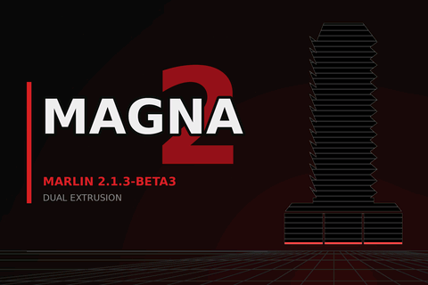
  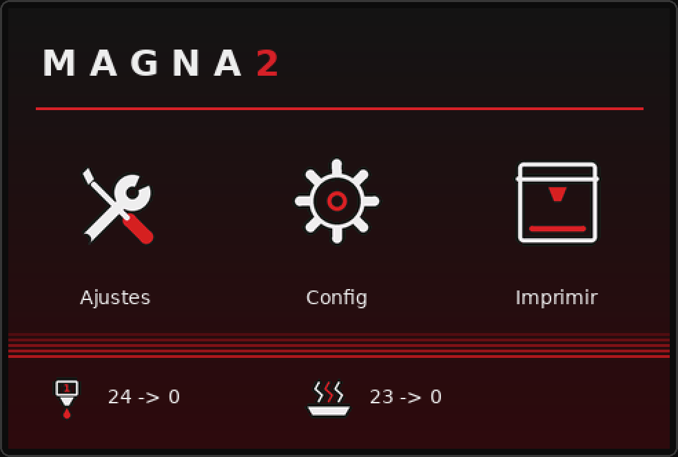
</p>

## Contenido

- [La pantalla](#la-pantalla)
  - [Pantalla principal](#pantalla-principal)
  - [Imprimiendo](#imprimiendo)
  - [Al terminar](#al-terminar)
  - [Mensajes, bloqueo y siempre encendida](#mensajes-bloqueo-y-siempre-encendida)
  - [Menús](#menús)
  - [Nivelación con BLTouch](#nivelación-con-bltouch)
- [Qué cambia en Marlin](#qué-cambia-en-marlin)
- [Ventilador del hotend automático](#ventilador-del-hotend-automático)
- [Hardware](#hardware)
- [Perfiles de slicer](#perfiles-de-slicer)
- [Firmware del WiFi](#firmware-del-wifi)
- [Compilar](#compilar)
- [Instalar](#instalar)
- [Calibrar](#calibrar)
- [Créditos](#créditos)

## La pantalla

Fondo oscuro con degradé, íconos de trazo blanco con detalles en rojo y una animación de arranque con una pieza que se imprime capa por capa. Todos los íconos los genera un script ([assets-tema/](assets-tema/)), no hay imágenes sacadas de otro lado. Tienen el mismo formato que los de Makerbase, así que para volver a los de fábrica alcanza con copiar la carpeta `assets` original.

Las capturas de abajo son el dibujo real de la librería gráfica de la pantalla (LVGL de MKS) con el mismo código del firmware; las genera una de las pruebas automáticas. En la de impresión le agregué a mano la imagen de la pieza, porque la prueba no la carga.

### Pantalla principal

Hora grande con la fecha, y los íconos de WiFi y de Telegram (prendidos si están andando). Abajo, mientras la cama y el hotend están calientes, el calor de la cama sube y al hotend se le cae una gota, y los números cambian de color y titilan hasta llegar a la temperatura. La hora la pasa el módulo WiFi con [MagnAir](#firmware-del-wifi); sin MagnAir la pantalla queda como siempre. Abajo a la derecha está el gráfico de temperaturas de los últimos 10 minutos.

<p>
  
  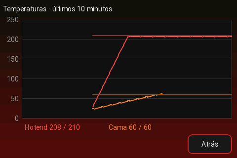
</p>

### Imprimiendo

Arriba la barra grande y una línea con la capa, lo que falta y a qué hora termina: `Capa 57/210 · faltan 2:15 · fin 23:25`. Si el gcode no trae miniatura aparece la pieza del arranque en lugar de la "G" de Makerbase.

Desde esta pantalla se puede cancelar una sola pieza cuando hay varias en la cama (las demás siguen), ver el gráfico y bloquear la pantalla. Mientras imprime, el ventilador gira según la velocidad, la barra tiene un brillo que la recorre, el calor de la cama sube, la gota del hotend cae y las temperaturas cambian de color hasta que llegan. Las animaciones se pueden apagar desde MagnAir.

<p>
  
  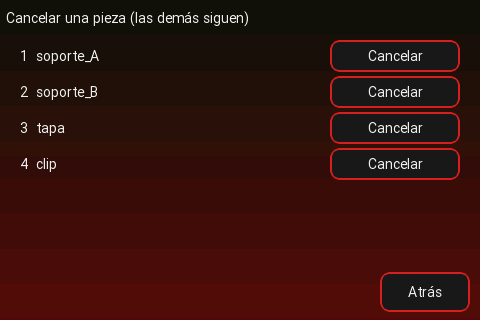
</p>

Para que aparezcan las capas y los nombres de las piezas, Cura tiene que agregar un par de líneas al gcode. Está explicado en [docs-magna/CURA-PANTALLA.md](docs-magna/CURA-PANTALLA.md). Si mandás el archivo desde el editor de la app MagnAir, lo agrega solo.

### Al terminar

Un resumen con lo que tardó, el filamento que usó y lo que costó, y una melodía corta. También suena otra cuando pide cambiar el filamento.

<p>
  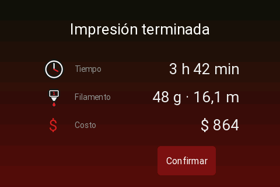
  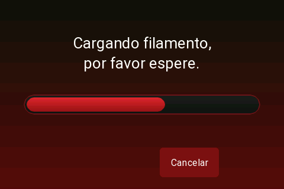
</p>

### Mensajes, bloqueo y siempre encendida

Desde la app, la página o el bot de Telegram se le puede mandar un mensaje a la pantalla ("cambiá el filamento a PETG negro"). El gcode también puede traerlos: el editor de la app los pone en la capa que elijas.

Mientras imprime se puede bloquear la pantalla para que nadie toque nada (se desbloquea deslizando), y si querés que no se apague hay un modo "siempre encendida" con la hora, el porcentaje y la hora de fin en grande.

<p>
  
  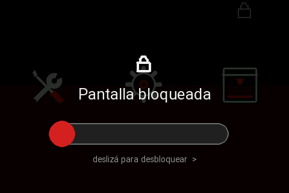
  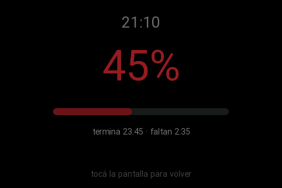
</p>

La pantalla se apaga sola a los 5 minutos sin tocarla. El primer toque solo la prende, y los avisos (falta de filamento, impresión terminada) también.

### Menús

Franja del título con la hora al medio, una línea roja tipo regla y "MAGNA 2" a la derecha. Los mensajes usan una letra más grande que la original y en *Ajustes → Más* agregué botones para calibrar el hotend y la cama, estacionar y cargar cada filamento del 2 en 1 sin escribir comandos.

<p>
  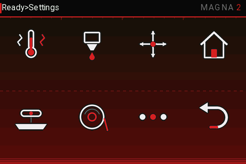
  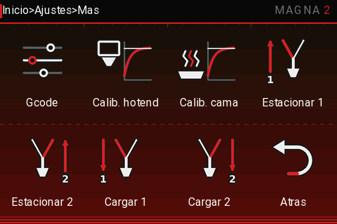
</p>

<p align="center"></p>

### Nivelación con BLTouch

Si tenés BLTouch hay una versión aparte del firmware con nivelación automática de 5 × 5 puntos. Mientras mide, la pantalla va mostrando el mapa de la cama con colores: verde está bien, amarillo y rojo son los puntos altos o bajos. Cómo conectarlo: [docs-magna/BLTOUCH.md](docs-magna/BLTOUCH.md).

<p>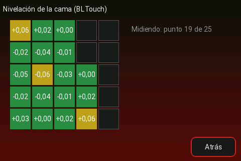</p>

## Qué cambia en Marlin

Los valores mecánicos (pasos, sentido de los motores, finales de carrera, termistores, aceleraciones y PID de la cama) salen de un firmware 2.1.2.1 que ya andaba bien en esta máquina. El detalle está en [docs-magna/CONFIGURACION.md](docs-magna/CONFIGURACION.md).

| Parámetro | Valor |
|---|---|
| Área de impresión | 230 × 230 × 250 mm |
| Pasos/mm X · Y · Z · E0 · E1 | 80 · 80 · 400 · 425 · 423 |
| Velocidad máxima | 300 · 300 · 5 · 25 · 25 mm/s |
| Aceleración máxima | 2000 · 2000 · 100 · 8000 · 8000 mm/s² |
| Jerk X · Y · Z · E | 10 · 10 · 0.3 · 5 |
| Temperatura máxima hotend / cama | 275 °C / 120 °C |
| Extrusores | 2 con una sola boquilla (hotend 2 en 1) |

Lo que activé:

- **Input Shaping** (`M593`) para imprimir más rápido con menos marcas en las esquinas.
- **MPC** para el hotend, que mantiene la temperatura más pareja que el PID. Se calibra con un botón.
- **Linear Advance** por extrusor (`M900`).
- **Cambio de filamento del 2 en 1**: los perfiles retiran el filamento 100 mm y cargan el otro, como el perfil de fábrica.
- **Dos sensores de filamento**, `M600` con "purgar más / continuar" en la pantalla y recuperación tras un corte de luz.
- **Cancelar objetos** (`M486`), tiempo restante del slicer (`M73`), babystep, contador de impresiones y apagado de los calentadores si quedan prendidos 10 minutos sin hacer nada.
- Comandos nuevos para que [MagnAir](#firmware-del-wifi) pueda prender y apagar la pantalla, leer la calibración y las estadísticas, entrar en carpetas de la SD y pasarle la hora y los mensajes a la pantalla.

## Ventilador del hotend automático

El ventilador del hotend se prende solo cuando pasa los 50 °C y se apaga cuando se enfría. Para eso tiene que estar conectado a la salida **HE1** de la placa, que en la Magna 2 230 viene libre: el cable verde al **+** y el blanco al **−**.

## Hardware

| | |
|---|---|
| Impresora | Hellbot Magna 2 230 |
| Placa | MKS Robin Nano **V1.3** (STM32F407, 512 KB) |
| Pantalla | MKS TFT35 táctil (480 × 320) |
| Extrusión | Doble extrusor Dual Drive con hotend 2 en 1 |
| Drivers | TMC2209 en X e Y |
| WiFi | MKS Robin WiFi (ESP8266) |
| BLTouch (opcional) | Conector BLTouch y Z-, con la versión BLTouch del firmware |

> Este firmware es **solo para la Robin Nano V1.3**. La V1.2 (STM32F103) y la V3 usan otros.

## Perfiles de slicer

En [perfiles-slicer/](perfiles-slicer/) hay perfiles hechos para esta máquina y este firmware:

| Slicer | Cómo se instala |
|---|---|
| Cura 5.10 o más nuevo | Doble clic en `cura/instalar-windows.bat` (o `instalar-mac-linux.sh`) |
| PrusaSlicer 2.6+ | Archivo → Importar → Importar paquete de configuración (`prusaslicer/`) |
| OrcaSlicer 2.x | Archivo → Importar → Importar configuraciones (`orcaslicer/`) |

Calidades 0.12, 0.20 y 0.28 para PLA, PETG y ABS, con doble línea de purga al empezar y la pieza al frente al terminar. Los tres salen del mismo script ([generar_perfiles.py](perfiles-slicer/generar_perfiles.py)) para que no queden distintos entre sí.

## Firmware del WiFi

Para el módulo WiFi hay dos opciones:

- **MagnAir**, mi firmware para el módulo, con página web, apps de Android y Windows y bot de Telegram. Es el que le pasa la hora, los mensajes y las opciones a la pantalla. Está en su propio repo.
- El **oficial de Makerbase** (CS1.0.4), en [wifi/](wifi/), por si querés volver al de fábrica.

## Compilar

Con GitHub Actions:

1. La primera vez, copiá los archivos de [github-workflows/](github-workflows/) a `.github/workflows/` en el repo.
2. Subí `mm2.zip` a la raíz del repo (Add file → Upload files).
3. El workflow descomprime el zip, baja Marlin oficial, le aplica la configuración y el tema, corre las pruebas y compila.
4. En Actions bajás **Magna2-230-firmware** o **Magna2-230-firmware-BLTouch**:

```
Magna2-230-firmware/
├── Robin_nano35.bin      firmware
├── assets/               íconos, logo y letras de la pantalla
├── opcional-wifi/        firmware oficial del WiFi
└── COMO-FLASHEAR.md
```

Para publicar una versión en Releases: Actions → Publicar versión Magna 2 230 → Run workflow (o un tag `v1.0`).

En la compu:

```bash
bash pruebas/armar-local.sh                      # baja Marlin y le aplica la configuración en build/
python3 assets-tema/aplicar_colores.py build     # aplica el tema
cd build && pio run -e mks_robin_nano_v1_3_f4
```

Antes de compilar se corren varias pruebas: los chequeos de Marlin sobre la configuración, los valores clave de la Magna, el formato de los íconos, que los perfiles coincidan con el firmware y el dibujo de las pantallas con la LVGL real (de ahí salen las capturas de arriba). Están en [pruebas/](pruebas/).

## Instalar

1. Guardá tus valores actuales: por USB, `M503`.
2. En una microSD en FAT32 copiá `Robin_nano35.bin` y la carpeta `assets`.
3. Con la impresora apagada, poné la SD y prendela. No la apagues mientras actualiza (primero el firmware y después los íconos).
4. Cargá la configuración nueva: `M502` y `M500`.

Paso a paso: [docs-magna/COMO-FLASHEAR.md](docs-magna/COMO-FLASHEAR.md). Para volver atrás se hace lo mismo con el `.bin` anterior.

## Calibrar

Después de instalar, en este orden ([docs-magna/CALIBRACION.md](docs-magna/CALIBRACION.md)):

1. Hotend (MPC): *Ajustes → Más → Calib. hotend*, con la máquina fría.
2. Cama (PID): *Ajustes → Más → Calib. cama*.
3. Linear Advance de cada extrusor: `M900 T0 K..` y `M900 T1 K..`, después `M500`.
4. Input Shaping: `M593 X F..` y `M593 Y F..`, después `M500`.

Antes de la primera impresión revisá temperaturas, finales de carrera y el sentido de los motores ([docs-magna/PRUEBAS-EN-IMPRESORA.md](docs-magna/PRUEBAS-EN-IMPRESORA.md)).

## Créditos

Creado por **Andrés Londero** · [andreslondero@gmail.com](mailto:andreslondero@gmail.com) (también figura en *Configuración → Acerca de* de la pantalla).

- [Marlin Firmware](https://github.com/MarlinFirmware/Marlin), licencia GPL-3.0. Acá solo está la configuración y lo que agregué.
- La interfaz de la pantalla es la MKS UI (LVGL) que viene con Marlin; la fuente `FontUNIGBK.bin` y el firmware oficial del WiFi son de [Makerbase](https://github.com/makerbase-mks).
- Los valores de la máquina salen del firmware 2.1.2.1 para la Magna 2 de [charlieburgos](https://github.com/charlieburgos/Hellbot-Magna-2).

> Usalo bajo tu responsabilidad. Antes de imprimir, verificá temperaturas, finales de carrera y el sentido de los motores.
